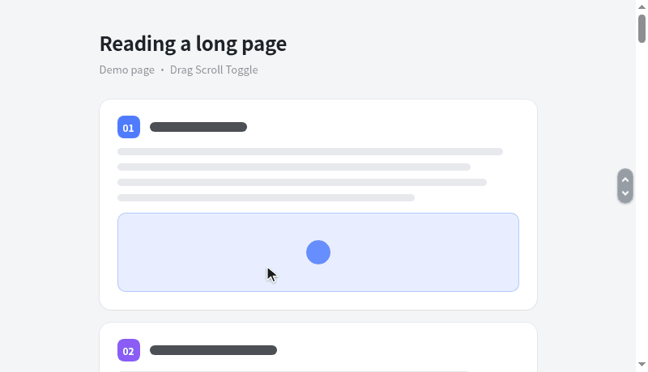
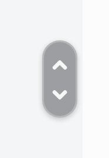
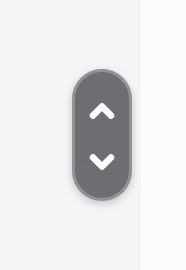
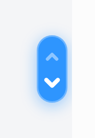
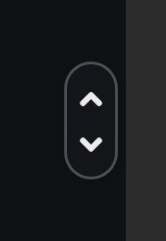
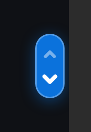

<div align="center">

# userscripts

**Small, dependency-free userscripts that make everyday browsing smoother.**

[](#installation)
[](#drag-scroll-toggle)
[](#drag-scroll-toggle)
[](#compatibility)
[](LICENSE)

</div>

## Scripts

| | Script | What it does | |
|:-:|---|---|:-:|
|  | **[Drag Scroll Toggle](#drag-scroll-toggle)** | A translucent switch next to the scrollbar. Turn it on and move the mouse to scroll: the farther away, the faster. | [**Install**](https://raw.githubusercontent.com/oexi/userscripts/main/drag-scroll-toggle/drag-scroll-toggle.user.js) |

## Installation

1. Install a userscript manager such as [Tampermonkey](https://www.tampermonkey.net/) or [Violentmonkey](https://violentmonkey.github.io/).
2. Click an **Install** link on this page. The manager opens its install screen; confirm there.
3. That's it. Updates are picked up automatically through each script's `@updateURL`.

> [!TIP]
> On recent versions of Chrome, userscript managers may also need **Allow User Scripts** switched on under `chrome://extensions` → the manager's **Details** page.

---

## Drag Scroll Toggle

<p align="center">
  
</p>

A small translucent toggle sits next to the page's scrollbar. Click it once, then just **move the mouse** — no button needs to be held:

- **Below the toggle** the page scrolls down, **above it** the page scrolls up.
- **Distance sets the speed.** The farther the cursor is from the toggle, the faster it scrolls.
- **Hold still** and it keeps scrolling at a constant speed. Move back to the toggle's height to pause.
- **Click anywhere**, click the toggle again, or press <kbd>Esc</kbd> to stop. That click is never passed to the page, so you won't follow a link by accident.

<p align="center">
  <a href="https://raw.githubusercontent.com/oexi/userscripts/main/drag-scroll-toggle/drag-scroll-toggle.user.js"></a>
</p>

### Appearance

<table align="center">
  <tr>
    <th></th>
    <th>Idle</th>
    <th>Hover</th>
    <th>Active</th>
  </tr>
  <tr>
    <th>Light page</th>
    <td></td>
    <td></td>
    <td></td>
  </tr>
  <tr>
    <th>Dark page</th>
    <td></td>
    <td></td>
    <td></td>
  </tr>
</table>

When active, the toggle turns blue and highlights the arrow for the current direction.

### Highlights

- **Shows up only when it's useful.** Hidden on pages that can't scroll, and never injected into iframes.
- **Finds the real scroll area.** On single-page apps where the window itself is locked and an inner panel scrolls (chats, dashboards, mail clients), it docks next to that panel's scrollbar and scrolls the panel. The mouse wheel scrolls it too while the toggle is active.
- **Stays responsive.** Scrolling bypasses `scroll-behavior: smooth`, so pages with smooth scrolling don't lag behind the cursor.
- **Hard to break.** The UI lives in a closed Shadow DOM, and its styles are applied as a constructable stylesheet, so it renders correctly even on sites with a strict `Content-Security-Policy`.
- **Out of the way.** No layout changes to the page, hidden when printing, `@grant none`, no dependencies.

### Configuration

Settings live in the `CONFIG` object at the top of the script.

| Option | Default | Description |
|---|:-:|---|
| `deadZone` | `10` | Pixels above and below the toggle where nothing scrolls. |
| `speedFactor` | `0.8` | Overall speed. Speed in px/s = `speedFactor × (distance − deadZone) ^ speedExponent`. |
| `speedExponent` | `1.5` | How sharply the speed ramps up with distance. |
| `maxSpeed` | `8000` | Upper speed limit in px/s. |
| `invert` | `false` | Reverse the direction (cursor below the toggle scrolls up). |
| `buttonTop` | `0.5` | Vertical position of the toggle within the visible scroll area. `0.5` is the middle, which gives equal travel in both directions. |
| `clickTolerance` | `6` | A press that moves less than this many pixels counts as a click and stops scrolling. Anything more is treated as a drag. |

With the defaults, a cursor 50 px away scrolls at about 200 px/s, 100 px at about 680 px/s, and 200 px at about 2,100 px/s.

> [!NOTE]
> If you change these values, consider turning off automatic updates for this script in your userscript manager so an update doesn't replace your edits.

### Compatibility

- **Chrome**: covered by automated end-to-end tests in Chrome 157 using real (trusted) mouse and keyboard input, including pages with inner scroll containers and a strict CSP.
- **Firefox**: not tested yet.
- **Touch**: desktop mouse and pen only. Touch input is ignored, since touch screens can already scroll directly.

### Known limitations

- Only the page's main scroll area is controlled. Content inside iframes is not scrolled.
- Elements in the browser's top layer, such as modal `<dialog>`s or fullscreen video, sit above the toggle and are not covered while it is active.

---

## Repository layout

```
drag-scroll-toggle/
├── drag-scroll-toggle.user.js   the script
└── assets/                      images used in this README
LICENSE                          GNU AGPL v3
```

## License

Copyright © 2026 oexi

Licensed under the [GNU Affero General Public License v3.0 or later](LICENSE) (`AGPL-3.0-or-later`). You may use, modify and redistribute these scripts, but modified versions you distribute or make available to others must be released under the same license with their source code.

<div align="center">
<sub>Found a bug or have an idea? <a href="https://github.com/oexi/userscripts/issues">Open an issue</a>.</sub>
</div>
